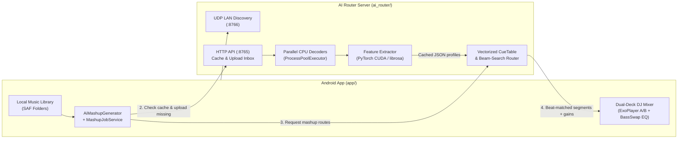

# SongMerger

> A small tool that automatically merges large amounts of songs into a single playlist based on their compatibility.

**SongMerger** pairs an **Android dual-deck DJ music player** (`app/`) with a **Python AI audio analysis & routing server** (`ai_router/`). It analyzes your local music library once—measuring harmony, timbre, rhythm, tempo, energy, vocal presence, and loudness—and automatically weaves compatible tracks into seamless, beat-matched DJ mashup playlists.

---

## Table of Contents

- [How It Works](#how-it-works)
- [Compatibility & Routing Engine](#compatibility--routing-engine)
- [Features](#features)
- [Project Structure](#project-structure)
- [Getting Started](#getting-started)
  - [1. Set Up the AI Routing Server](#1-set-up-the-ai-routing-server)
  - [2. Build & Install the Android App](#2-build--install-the-android-app)
  - [3. Generate Your First Mashup](#3-generate-your-first-mashup)
- [API & Format Reference](#api--format-reference)
- [Testing & Verification](#testing--verification)
- [Note](#note)

---

## How It Works

SongMerger splits heavy audio signal processing and low-latency playback across two components communicating over your local network (LAN/WAN):



1. **Auto-Discovery & Cache Check**: The app finds the server automatically on Wi-Fi (UDP port `8766`) and sends track IDs with file fingerprints (`size-modifiedMs`). Songs already analyzed are skipped.
2. **Parallel Upload & Analysis**: Missing tracks are uploaded in parallel (3 at a time) to the server inbox, decoded across multiple CPU worker processes, and analyzed on a CUDA GPU (or CPU fallback).
3. **Matrix Scoring & Routing**: All outgoing-to-incoming cue point pairs are scored simultaneously as a vectorized NumPy matrix, and beam search builds diverse mashup playlists.
4. **Seamless Dual-Deck Playback**: The Android app plays the resulting segments across two ping-pong `ExoPlayer` decks with beat-aligned crossfades, real-time bass-swap EQ, tempo matching, and loudness leveling.

---

## Compatibility & Routing Engine

### Audio Profiling (`ai_router/audio_analyzer.py`, `ai_router/gpu_features.py`)
Each track (≥ 18 seconds, up to 10 minutes) is analyzed once and cached as a compact JSON profile:
- **Beat Grid & BPM**: Estimates tempo (folded into the standard `84–168` BPM DJ range) and constructs a complete beat grid.
- **Phrase-Boundary Cues**: Selects up to **16 beat-snapped, bar-aligned cue points** per track (including intro/outro anchors) using spectral novelty and energy jumps.
- **Directional Windows**: Extracts both outgoing (`[cue - 8 beats, cue]`) and incoming (`[cue, cue + 8 beats]`) feature descriptors—Chroma, Tonnetz, MFCCs (`1..12`), Spectral Contrast, Spectral Centroid, RMS Energy, Onset Strength, a 32-step beat-synchronous rhythm signature, and a mid-band lead vocal presence estimate.
- **Loudness**: Measures gated RMS loudness (`loudness_db`) from the original peak so transitions maintain a consistent volume.

### Transition Scoring (`ai_router/router_engine.py`)
Every candidate exit cue from Track A and entry cue into Track B is scored in `[0, 1]`:

| Factor | Weight | Description |
| --- | :---: | --- |
| **Harmonic Consonance** | `28%` | Direct pitch-class chroma match, fifths/relative-key shifts (`+7`/`-5` semitones), and Tonnetz similarity |
| **Timbral Similarity** | `24%` | MFCC (`65%`) and Spectral Contrast (`35%`) cosine similarity |
| **Rhythm & Tempo** | `22%` | Peak 4-phase beat-shifted rhythm correlation × BPM compatibility (within `±8.5%`, supporting `0.5x`/`2.0x` half/double-time) |
| **Energy Continuity** | `16%` | Exponential closeness of outgoing vs. incoming RMS energy |
| **Spectral Brightness** | `10%` | Exponential closeness of spectral centroids (Hz) |
| **DJ Flow Bonus** | `+0.12` max | Prefers exiting in the second half of Track A and entering in the first half of Track B |
| **Vocal Clash Penalty** | up to `-0.18` | Penalizes overlapping windows that both carry strong lead vocals |

### Playlist Assembly
- **Beam Search (`BEAM_WIDTH = 16`)**: Generates multiple diverse playlists per request (with penalties on reused song-to-song edges and optional starting seed track).
- **DJ Blend Parameters**: Computes whole-beat crossfade durations (`2`, `4`, `8`, or `16` beats within `2.5–5.5 s`), initial tempo-matching ratios (`0.92x–1.08x`), and per-segment loudness attenuation (`gain_db` down to `-12 dB`, leveled to the route's median).

---

## Features

### AI Mashups & Route Editing
- Generate mashups from **All Tracks**, **Favorites**, or any **Playlist** (customizable mashup count, tracks per mashup, and optional seed song).
- Background execution via Android foreground service (`MashupJobService`) with progress notifications and automatic job resumption if the app is closed mid-analysis.
- Interactive **Step Editor** to fine-tune any track's entry point, exit point, crossfade duration, and initial tempo ratio.
- Copy, edit, or share mashups as compact **route strings** (e.g., `Song A,1:45,Song B,0:33,Song B,2:45,Song C,0:15`).

### Dual-Deck DJ Playback Engine
- **Ping-Pong Dual Decks (`DjCrossfader`)**: Arms the idle `ExoPlayer` deck 3.5 seconds before a transition, syncs beat phase if triggered late, applies a fast bleed-in (`t^0.55`) / cosine fade-out curve, and glides tempo smoothly back to `1.0x`.
- **Real-Time Bass-Swap EQ (`BassSwapProcessor`)**: 2nd-order Butterworth high-pass filter (`< 145 Hz`) cuts sub-bass on the incoming deck and swaps low-end with the outgoing deck mid-transition to prevent kick/bass clashes.
- **Everyday Controls**: Configurable `0–12 s` crossfade for normal songs, playback speed (`0.5x–2.0x`), skip silence, sleep timer (`15/30/45/60 min` or end-of-track with a 5-second fade-out), and persistent queue memory across restarts.

### Music Library & Player UI
- **Local Folder Library**: Pick one or more folders via Android's Storage Access Framework (SAF) with fast incremental rescans (`.mp3`, `.m4a`, `.aac`, `.flac`, `.ogg`, `.oga`, `.opus`, `.wav`, `.wma`).
- **Smart Artist Handling**: Customizable multi-artist separator (e.g., `,` or `;`) plus per-song manual artist overrides without modifying audio files.
- **Vinyl Turntable UI**: Spinning cover-art vinyl disc with tap-to-play/pause, swipe-to-skip carousel, and **hold-and-turn scrubbing** (30 seconds per turn with haptic detents), backed by dynamic ambient cover lighting (`CoverAmbienceView`).
- **Inline Queue & Lyrics**: Toggleable inline queue (drag-to-reorder, swipe-to-remove, multi-select, shuffle animations) and synchronized `.lrc` / embedded lyrics viewer with tap-to-seek.

### Import, Export & Automation
- **M3U / M3U8 Round-Trip**: Export and import `.m3u` / `.m3u8` playlists, including a custom `#EXTMIX:` directive that preserves mashup cue points, fades, tempo ratios, and loudness gains.
- **External App Playlist Capture**: Import playlists from other Android music apps using Notification Access (`MediaCaptureService` + `PlaylistImporter`).
- **Single-Track Broadcast Import**: Instantly index a newly downloaded song from external tools (such as Termux) without running a full rescan.

---

## Project Structure

```text
SongMerger/
├── ai_router/                   # Python AI analysis & mashup routing server
│   ├── server.py                # Multi-threaded HTTP API + UDP LAN discovery + self-test
│   ├── audio_analyzer.py        # Beat grid, phrase cue detection, descriptors & JSON cache
│   ├── gpu_features.py          # PyTorch CUDA/CPU STFT feature extractor (librosa fallback)
│   ├── router_engine.py         # Vectorized CueTable scoring & beam-search playlist generator
│   ├── jobs.py                  # Upload inbox & background parallel decode/analysis job runner
│   ├── requirements.txt         # Core Python dependencies (CPU / librosa)
│   ├── requirements-gpu.txt     # Optional PyTorch CUDA 12.8+ dependencies
│   └── README.md                # Server-specific setup & endpoint documentation
├── app/                         # Android Kotlin client (Media3 / ExoPlayer)
│   └── src/
│       ├── main/java/me/Integer/Mediaplayer/
│       │   ├── library/         # SAF scanning, AI client/generator, M3U8 codec, importer
│       │   ├── playback/        # PlaybackService, DjCrossfader, BassSwapProcessor, QueueMemory
│       │   └── ui/              # Library, Now Playing, VinylDiscView, Mashup dialogs, Settings
│       └── test/                # JVM unit tests
├── push.py                      # Helper script to build debug APK & install via adb
└── build.gradle                 # Gradle build configuration (AGP 9.0.1, Gradle 9.3.1)
```

---

## Getting Started

### 1. Set Up the AI Routing Server

Requires **64-bit Python 3.11 or 3.12** on a machine reachable by your phone over LAN/WAN.

```bash
cd ai_router
python -m venv .venv
```

Activate the virtual environment:
- **Windows (PowerShell)**: `.venv\Scripts\Activate.ps1`
- **Linux / macOS**: `source .venv/bin/activate`

Install dependencies:
```bash
pip install -r requirements.txt

# Optional: enable NVIDIA GPU acceleration (CUDA 12.8+, required for RTX 50-series)
pip install -r requirements-gpu.txt
```

Start the server:
```bash
python server.py --host 0.0.0.0 --port 8765 --token YOUR_SECRET_TOKEN
```

> [!TIP]
> - Without `requirements-gpu.txt`, the server automatically falls back to CPU analysis via `librosa`.
> - Using `--token` (or the `AI_ROUTER_TOKEN` environment variable) is strongly recommended when listening on `0.0.0.0`.
> - On Windows, allow Python through Windows Firewall on private networks so your phone can connect.
> - See [`ai_router/README.md`](ai_router/README.md) for full server options (`--device`, `--workers`, `--cache-dir`).

### 2. Build & Install the Android App

**Requirements**:
- **Android 11+** (`minSdk 30`, `targetSdk 36`)
- **JDK 17+** (JDK 21 recommended, configured in `gradle/gradle-daemon-jvm.properties`)
- **Android SDK** (`compileSdk 36`) & `adb` platform-tools

**Option A — One-command build & install (`push.py`)**:
```bash
python push.py
```
`push.py` locates a compatible JDK 17+, prompts to choose a connected device if multiple are attached (or reads `ANDROID_SERIAL`), builds `:app:assembleDebug`, and installs it via `adb`.

**Option B — Gradle directly**:
```bash
./gradlew :app:assembleDebug
adb install app/build/outputs/apk/debug/app-debug.apk
```

### 3. Generate Your First Mashup

1. Open **Media Player** on your phone and tap **Add music folder** to grant access to your local music directory.
2. Open **⋮ → Settings → AI Mashup Server**:
   - Tap **Find server on Wi-Fi** for automatic LAN discovery, or enter the server address (e.g., `http://192.168.1.50:8765`) and optional token manually.
   - Tap **Test server connection** to confirm connectivity and active GPU/CPU device.
3. Return to the library and select **⋮ → Generate AI mashups** (or open a playlist and choose **⋮ → Make AI mashups**).
4. Pick your source tracks, desired number of mashups, tracks per mashup, and optional starting track, then tap **Generate**.
5. Once ready, tap any generated mashup to **Play now** or **Save as playlist**.

---

## API & Format Reference

### Server Endpoints (`/api/v1/*`)
All requests must include `X-Auth-Token: <token>` when `--token` is enabled.

| Endpoint | Method | Purpose |
| --- | :---: | --- |
| `/api/v1/health` | `GET` | Server status, cached track count, and active analysis device |
| `/api/v1/check-cache` | `POST` | Returns `missing_ids` (unanalyzed) and `stored_ids` (already uploaded in inbox) |
| `/api/v1/upload-track` | `POST` | Stores raw audio (`≤ 80 MB`) using `X-Track-*` headers (kept for 30 days) |
| `/api/v1/analyze` | `POST` | Starts an asynchronous decode + feature extraction job for stored track IDs |
| `/api/v1/jobs/<job_id>` | `GET` | Polls job phase (`queued`, `analysing`, `done`, `failed`) and progress counts |
| `/api/v1/route` | `POST` | Computes compatible mashup playlists with structured segments and route strings |

### Compact Route String Format
Mashups can be viewed, copied, and manually edited as comma-separated exit/entry pairs:
```text
Song A,1:45,Song B,0:33,Song B,2:45,Song C,0:15
```
*(Play Song A from `0:00` to `1:45` → blend into Song B at `0:33` → play until `2:45` → blend into Song C at `0:15` through the end.)*

### Extended M3U8 (`#EXTMIX:`)
Exported mashup playlists remain standard `.m3u8` files while preserving transition metadata:
```m3u
#EXTM3U
#PLAYLIST:AI Mashup #1
#EXTINF:201,The Weeknd - Blinding Lights
#EXTMIX:start=0,end=106998,fade=3750,tempo=1.0000,gain=-1.20
The Weeknd - Blinding Lights.mp3
```

### Instant Single-Song Import (Termux / Automation)
Add a newly downloaded file located inside an already-configured music folder without a full library rescan:
```bash
am broadcast -n me.Integer.Mediaplayer/.library.AddTrackReceiver \
  -a me.Integer.Mediaplayer.ADD_TRACK \
  --es name "Artist - Title.mp3"
```

---

## Testing & Verification

**AI Router Self-Test** (synthesizes test audio, runs upload inbox, parallel decode workers, feature extraction, matrix verification against scalar scoring, and mashup routing):
```bash
cd ai_router
python server.py --self-test
```

**Android Unit Tests** (pure-Kotlin tests for route parsing, track matching, artist splitting/grouping, queue codec/ordering/diffing, playback clock, and UI physics/math):
```bash
./gradlew testDebugUnitTest
```

---

## Note

> [!NOTE]
> This project is mostly AI-generated, with **Claude Opus 5.5** and **Gemini Argon** being the two most prominent contributors.
